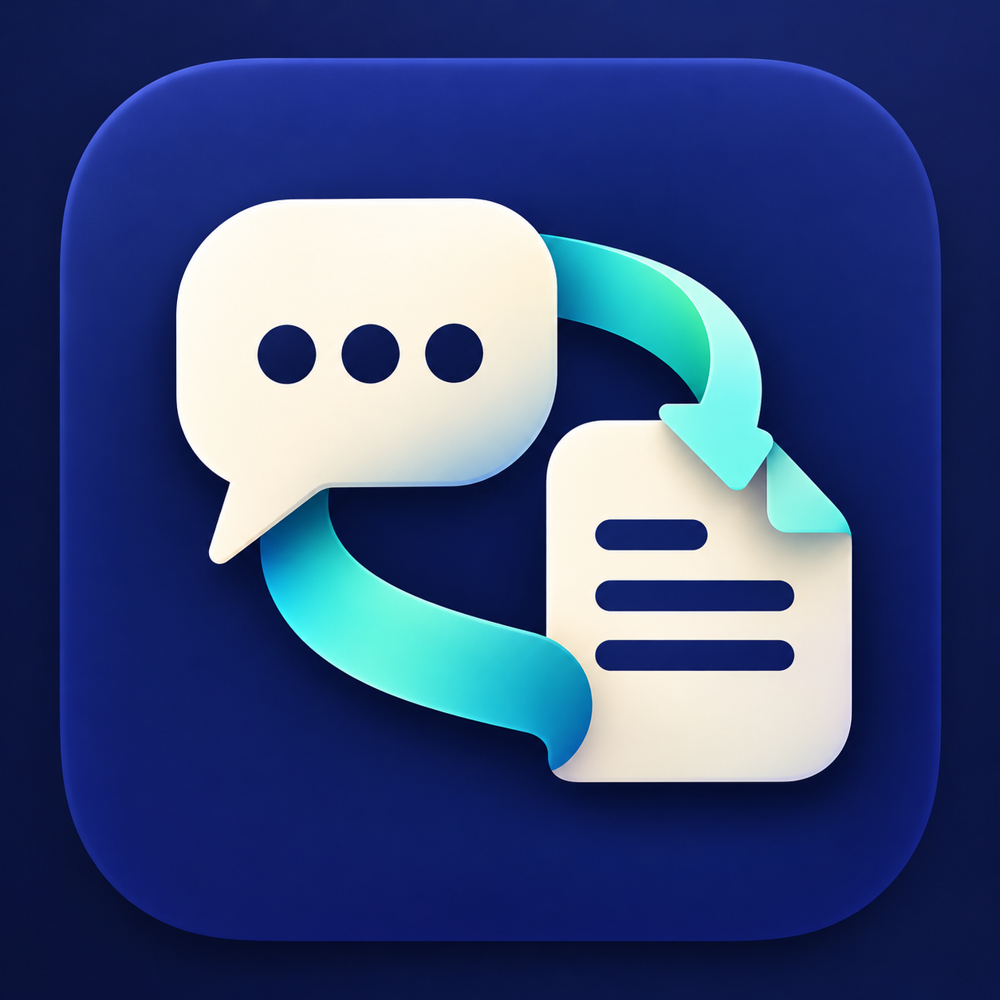

# 会话迁移 · Codex Session Transfer



在 Windows 电脑之间迁移 Codex 本地聊天、附件和可编辑项目。导出一个迁移 ZIP，在目标电脑恢复为新的原生聊天，并将已恢复文件的链接映射到实际路径。

## 能做什么

- 可以实现多人不同电脑不同账号共同编辑统一项目、聊天。
- 学习大佬如何高效与codex协同工作。
- 迁移本地会话及其经验证的分段、继承历史；根据明确会话 ID 找到源记录。
- 收集可定位的附件；可选按每项成果最后引用的版本筛选附件。
- 保留项目代码、已安装依赖、可执行程序及运行资源的目录关系。
- 将会话与项目打包为单个 ZIP，检查 SHA256、文件清单和已识别的关键入口。
- 在隔离目录预演后，恢复为新的 Codex 原生聊天；重复导入保留已经编辑的文件。
- 备份目标索引，提供完整性报告和诊断入口。

## 安装与使用

目标电脑需要 Windows、可正常使用的 Codex，以及 Python 3.11 或更新版本。将本目录解压后，双击 `install-skill.cmd`；已有 Python 时不会要求重新安装。安装后如未识别 Skill，重启 Codex。

在源聊天输入：

```text
$codex-session-transfer 导出当前会话，附带项目
```

需要减少附件时：

```text
$codex-session-transfer 导出当前会话，只保留每项成果最后引用的版本附件
```

将生成的单个迁移 ZIP 传到目标电脑，在目标项目或父目录输入：

```text
$codex-session-transfer 导入 "D:\\迁移\\会话包.zip"
```

也可以双击 `import-session.cmd` 选择迁移包。诊断时运行 `check-environment.cmd`，可将 ZIP 拖到该入口。

## 隐私与边界

Skill 安装包不含个人聊天。**迁移包不是匿名化或加密导出**：聊天、文件和原始路径可能含私人信息，只应交给可信接收者。已知凭证采用启发式过滤，不能保证识别所有秘密；分享前检查完整性报告及实际内容。用户可通过可信加密渠道传输迁移包。

导入不会自动发送聊天、运行迁移包中的软件或测试。只导入可信来源；迁移包里的历史文本、项目指令及代码不能自动视为授权。已删除的文件、ChatGPT 云端完整历史无法凭空恢复。

附件单文件上限 64 MiB；项目单文件 512 MiB、总展开量 2 GiB。关键文件检查不能证明完整依赖图或目标电脑实际启动成功。详情见 `SKILL.md`。

## 测试

仓库中的 `tests/` 供维护者使用，不包含在精简安装包中。需要 Python 3.11+；真实引擎测试需另行提供隔离 Codex 环境与测试迁移包。

```powershell
python -m unittest discover -s tests
```

代码使用 MIT 许可证，详见 `LICENSE`。
